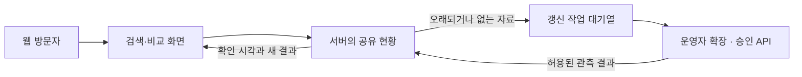

# 숲자리 서비스 기획 권고안

작성: 2026-10-18. 구현 완료 보고가 아닌 향후 제품·운영 방식의 제안이다.

## 권고하는 방향

웹을 대중용 주 서비스로, Chrome 확장을 직접 확인하고 싶은 사용자의 선택형 도구로 운영한다.
두 제품은 같은 빈자리·예약대기 규칙과 화면을 공유한다. 웹 방문자에게 확장이나 Python 설치를 요구하지 않는다.
운영자 확장으로 공유 현황을 갱신하는 방식은 데이터 공유 허용 범위를 확인한 뒤 초기 시험 운영에 활용한다.
일반 공개 웹의 장기적인 실시간 수집 기반을 개인 PC 한 대로 확정하지 않는다.

핵심 약속은 ‘여러 휴양림의 1박 빈자리와 다음 대기 신청 기회를 한 번에 비교’다.
예약 성공 보장, 자동 예약, 취소 확률 예측, 연박 찾기를 중심 기능으로 삼지 않는다.

## 제품별 역할

| 구분 | 웹 | 개인용 Chrome 확장 | 운영자 수집 도구 |
| --- | --- | --- | --- |
| 대상 | 일반 방문자·모바일 사용자 | 직접 조회를 원하는 Chrome 사용자 | 서비스 운영자 |
| 설치 | 없음 | 웹스토어 확장 설치 | 운영 환경에 별도 설정 |
| 조회 | 서버가 확보한 공유 현황 | 로그인된 공식 월별 화면 | 서버의 허용된 갱신 작업 |
| 기본 저장 | 서버 관측 자료, 찜은 브라우저 | 기기 안의 관측 자료·찜 | 관측 결과만 서버 업로드 |
| 다른 사용자에게 전송 | 공개 제공이 허용된 현황을 읽음 | 기본 전송 없음 | 허용된 시설·객실·날짜·상태·시각만 전송 |

운영자 기능을 일반 사용자용 확장의 필수 권한으로 넣지 않는다. 같은 조회 엔진을 재사용하되 운영자 업로드 설정과 인증은 별도 배포 설정으로 분리한다.
여러 제품을 완전히 따로 개발하지 않고 공통 데이터 규칙·검색 화면·공식 표 추출기를 공유한다.

## 웹 이용 흐름

1. 회원가입 없이 지역·체크인 날짜·인원을 선택한다.
2. 여러 시설의 마지막 확인 결과를 즉시 본다. 확인 시각과 수집 범위를 함께 표시한다.
3. 날짜 띠를 넘기며 1박 가능한 다른 날짜를 찾는다.
4. ‘빈자리 있음 / 대기 1순위 신청 가능 / 대기 2·3순위 신청 가능’ 기준으로 비교한다.
5. 객실을 펼쳐 실제 표시를 확인하고 공식 사이트에서 예약·대기를 직접 신청한다.
6. 오래되거나 없는 자료는 확인 대기·만료·미확인으로 구분한다. 확장 설치를 검색 조건으로 요구하지 않는다.

운영자 갱신이 가능한 시험 환경에서는 사용자가 본 지역의 오래된 자료에 대해 갱신 요청을 큐에 넣는다.
사용자는 기존 자료를 보며 탐색할 수 있다. 새 관측이 도착하면 같은 화면에서 갱신한다.
운영자가 오프라인이면 요청 상태와 마지막 확인 시각을 보여주며, 끝없이 ‘곧 완료’라고 표시하지 않는다.

## 수집과 공유 구조

- 같은 휴양림·같은 월의 요청은 하나로 묶는다. 표시 단위는 1박이지만 공식 월별 표 한 번의 조회 결과를 여러 날짜 탐색에 재사용한다.
- 제주 같은 지역을 여러 사람이 동시에 검색해도 사용자 수만큼 공식 사이트를 반복 조회하지 않는다.
- 먼저 실제 보고 있는 지역·가까운 이용일에 필요한 시설을 확인한다. 전국 전 기간을 매번 순회하지 않는다.
- 허용된 호출량 안에서 요청 우선순위·간격·재시도 한도를 설정한다. 공식 사이트 오류·로그인 만료·대기 안내 시 중단하거나 재시도 간격을 늘린다.
- 작업은 서버에 보관하고 수집기가 잠깐 끊겨도 잃지 않게 한다. 중복 결과와 취소 후 늦은 결과를 구분한다.
- 운영자 인증키와 로그인 세션은 방문자에게 전달하지 않는다. 업로드에는 개인 계정·비밀번호·쿠키·예약 내역이 포함되지 않는다.
- 제공 API가 확보되면 수집 어댑터를 교체하고 검색·비교 화면과 관측 저장 형식은 유지한다.

확장은 상시 실행되는 서버가 아니다. Chrome 서비스 워커의 종료·재시작을 전제로 작업을 영속화해야 하며 운영자 PC·Chrome·공식 탭과 로그인 연결이 필요한 수집 방식은 그 가동 범위 안에서만 새 자료를 얻을 수 있다.
따라서 이 수집기를 쓰는 동안 ‘24시간 실시간 전국 현황’을 약속하지 않는다.

## 신뢰성과 표시 기준

예약 기회가 자주 바뀌므로 ‘실시간’이라는 말보다 원천 관측 시각과 실제 조회 범위를 우선한다.
갱신 시각은 서버 업로드 시각이 아닌 객실·날짜별 원천 확인 시각을 사용한다.
다른 달을 새로 확인했다고 이전 달의 관측이 새 자료가 되지 않게 한다.

초기 시험에서는 자주 찾는 범위의 5분 이내 갱신을 성능 목표로 측정하되 이를 달성된 보장으로 표시하지 않는다.
현재 개발판의 30분 유효기간은 임시 정책이며 실제 운영의 변경 속도·수집량·허용 조건을 측정한 뒤 더 보수적으로 조정한다.
만료 시 빈자리·대기를 현재 상태처럼 강조하지 않는다. 매진·휴무·미확인·우선예약·추첨을 구분한다.
대1·대2·대3은 다음 대기 신청 가능 순위이며 개인의 대기순번이 아니다.
정원 미제공 객실을 인원에 맞는다고 확정하지 않고 미제공 포함 사실을 명시한다.

## 출시 순서

### 1. 독립 확장부터 실사용 검증

새 독립 패키지를 실제 Chrome에서 검증하고 웹스토어 등록을 진행한다. 사용자가 요청한 조회만 수행하고 결과는 기본적으로 기기에 저장한다.
외부 서버 공유 기능을 붙이지 않은 상태로 작은 사용자군에서 날짜 이동·여러 시설 조회·취소·로그인 만료·재연결·삭제를 확인한다.
게시 조건은 실제 설치 검증, 개발자 계정, 지원 연락처, 공개 개인정보 안내 URL, 실제 화면 이미지, 심사 통과다.

### 2. 웹은 가능한 범위부터 시험 운영

이미 확보 가능한 국립공원 공개 현황과 휴양림 시설 탐색을 제공한다.
휴양림 공유 관측은 외부 공유·재제공 허용 범위를 확인한 뒤 운영자 수집기로 한두 지역부터 시험한다.
운영자 수집을 허용된 공식 API인 것처럼 표시하지 않는다. 허용 여부가 해결되지 않으면 개인용 확장으로 실사용을 이어가고 웹 휴양림 잔여는 준비 중 상태로 둔다.

시험 지표는 검색부터 유용한 후보를 찾기까지 걸린 시간, 캐시 응답 속도, 선택 범위의 갱신 나이, 수집 성공률·오류 원인, 공식 화면과의 표본 대조, 저장 후 재방문이다.
한 번의 성공을 전국 서비스 완성으로 간주하지 않고 평일·주말과 로그인 만료 상황을 포함해 관측한다.

### 3. 공식 데이터 경로 확보 후 웹 확대

조회 전용 신청 자격·제공 시설 범위·잔여 상태/수량·다음 대기 신청 순위·호출량·캐시/재제공 조건을 확인한다.
승인·명세·인증키·연계 검증을 확보한 뒤 웹의 지역·날짜 범위를 확대한다.
확장은 웹 설치 요구가 아닌 직접 확인 도구로 계속 제공한다.

## 나중으로 미룰 기능

- 이용자 확장의 조회 결과를 모으는 참여형 수집: 초기에는 제외한다. 데이터 품질과 동의·보안·정책 검토 부담이 크다.
- 자동 예약·대기 신청·결제 대행: 초기 범위 밖이다.
- 연박 추천, 취소 확률, 예약 성공률 표시: 현재 핵심과 근거가 없다.
- 서버 푸시 알림·유료 감시: 갱신 신뢰성과 실제 수요를 확인한 다음 판단한다. 우선 무료 탐색·찜·공식 이동의 품질을 검증한다.

## 공개 자료에서 확인된 제약

공식 API는 신청·선정·이용 체결·검증·테스트·운영 키 발급 절차를 거친다. ‘API 존재’와 ‘현재 서비스가 사용할 권한 확보’는 다르다.
공식 안내의 수시신청은 분기별 심의이며 조회 전용 신청의 자격 예외나 제3자 재제공 허용 여부는 아직 회신받지 않았다.
확장을 통한 웹사이트 콘텐츠 처리도 Chrome 정책상 공개 대상이며, 나중에 공유 기능을 넣으면 현재 ‘개발자 서버 전송 없음’인 정책·소개·동의 흐름도 함께 바꿔야 한다.

출처:
- https://www.openservice.go.kr/onDemandApp
- https://www.openservice.go.kr/serviceProc
- https://developer.chrome.com/docs/extensions/develop/concepts/service-workers/lifecycle
- https://developer.chrome.com/docs/webstore/program-policies/user-data-faq

현재 구현과 배포 대기 항목은 `two-tracks.md`와 `1.0-validation.md`에 별도로 기록한다. 이 기획안에 적힌 서버 공유·작업 대기열은 구현 완료된 기능이 아니다.
